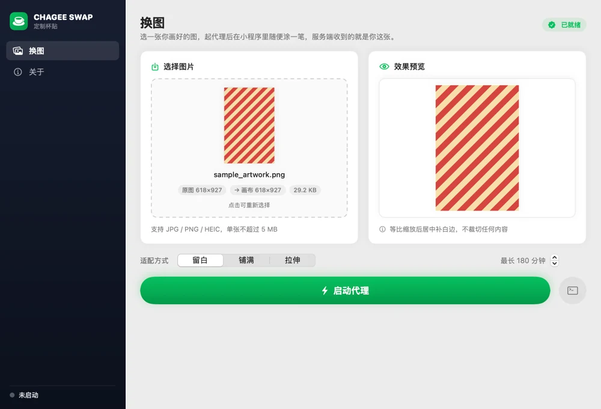
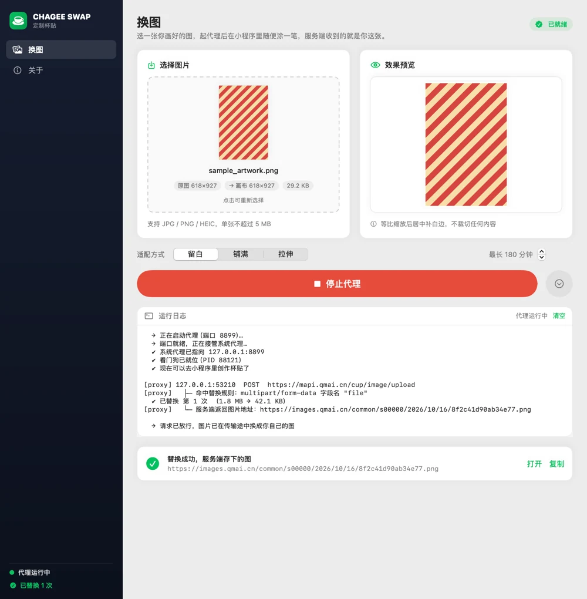
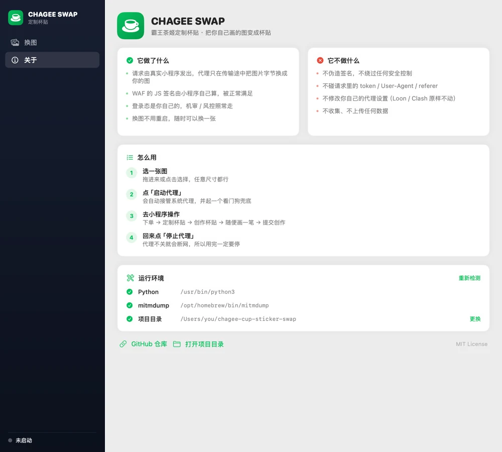
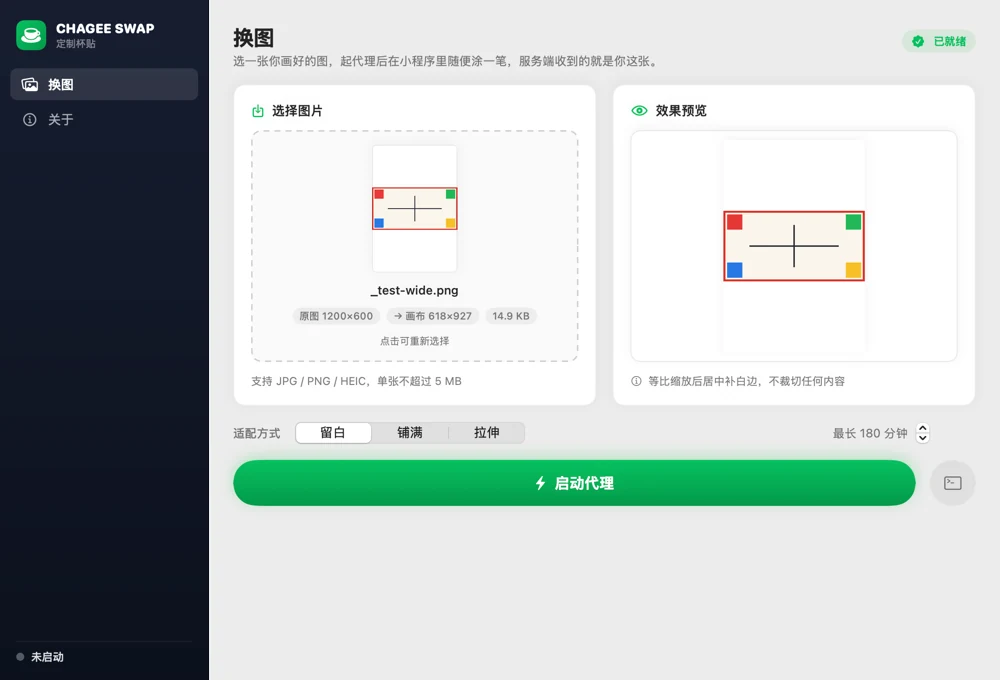

# 霸王茶姬「定制杯贴」外部上传脚本

小程序自带的画布只能手绘，画不了细线、渐变、文字排版。这里给你两条路把在
Photoshop / Procreate / Illustrator / Figma 里画好的图变成你的杯贴：

| 路线 | 做法 | 状态 |
| --- | --- | --- |
| **mitm 代理替换**（推荐） | 请求由真实小程序发出，代理在传输途中换掉图片字节 | ✅ **可用**，WAF/风控/登录态全部天然通过 |
| 纯 HTTP 脚本 | 自己构造请求直接调官方接口 | ⚠️ 上传成功，但 `save` 被 WAF / 风控拦（见下文实测） |

两条路的接口调用链是一样的：

| 步骤 | 接口 | 说明 |
| --- | --- | --- |
| ① | `POST webapi.qmai.cn/web/common-center/upload/image/index` | `multipart/form-data`，字段名 `upfile`，文件名 `<10位随机数字>.png`，返回图片 CDN 地址 |
| ② | `POST cuswebapp.qmai.cn/web/custom-center/cup-label/save` | `{"imgUrl":"<上一步地址>","createType":1,"language":"zh-CN"}` |

画布尺寸实测为 **618 × 927**（RGBA PNG），两条路都按这个尺寸适配。



> **想直接能用：有图形界面。** `./macos/build.sh --run` 构建并打开
> `CHAGEE SWAP.app`，拖张图进去、点「启动代理」就行 —— 见「[用法](#用法)」。
>
> 命令行党跳到「[mitm 代理替换](#mitm-代理替换推荐路线)」。
> 下面的纯 HTTP 路线保留了完整的排错过程和实测数据，可以当参考。

## 安装

```bash
git clone https://github.com/1128-66/chagee-cup-sticker-swap.git
cd chagee-cup-sticker-swap

# 推荐路线要 mitmproxy（自带 CA 证书工具）
brew install mitmproxy

# 预适配（自动裁切/缩放）要 Pillow
pip install Pillow
```

- **Python**：3.9+（纯标准库即可跑，Pillow 只有预适配用得上）
- **mitmproxy**：推荐路线必需
- 不装 Pillow 也能用，前提是原图已经是 618×927，此时加 `--fit none`

装完可以先跑一遍自检（不联网、不需要真实流量）：

```bash
python3 selftest_replace.py     # 18 项
```

## 拿凭证

脚本支持直接从你自己抓的 HAR 里提取 token / cookie，不用手填：

```bash
python3 cup_sticker.py --har <你的 traffic.har> --save-config
```

这会把凭证写进同目录的 `config.json`（权限 600）。

> `config.json` 里的 `user_token_*` 等同于你的登录态，**不要提交到 git、不要外发**。
> token 会过期（通常几小时到几天），过期后重新抓一次 HAR 再跑一次 `--save-config` 即可。

## 用法

### 方式零：图形界面 app（最省事）

原生 SwiftUI 写的 `CHAGEE SWAP.app`，把「选图 → 适配 → 起代理 → 停代理」收进一个窗口：

```bash
./macos/build.sh --run          # 构建并打开（首次会生成图标、ad-hoc 签名）
```

拖一张图进去，点「启动代理」，去小程序里创作杯贴，回来点「停止代理」。
界面会实时显示日志、替换次数，以及服务端最终存下的图片地址。

| 运行中 | 关于 |
| --- | --- |
|  |  |

构建细节见 [构建 macOS app](#构建-macos-app)。

### 方式一：双击 `.command`（命令行路线，推荐）

在 Finder 里双击 **`选图上传杯贴.command`**，会弹终端窗口，然后：

1. 弹出 macOS 选图面板 → 选你画好的图（任何尺寸都行）
2. 选适配方式：`不裁切，留白边（推荐）` / `铺满画布，裁掉边缘` / `拉伸填满，会变形`
3. 自动上传 + 保存，成功后弹窗提示，并把图片地址复制到剪贴板

也可以**把图片直接拖到这个 .command 文件上**，会跳过选图面板。

> 首次双击如果被 macOS 拦（"无法打开，因为来自身份不明的开发者"），
> 右键 → 打开 → 再点"打开"即可。或者先在终端里跑一次：
> `chmod +x 选图上传杯贴.command`

### 方式二：命令行

```bash
# 0) 先体检：token 有没有过期、接口通不通、WAF 放不放行
python3 cup_sticker.py --check

# 1) 看看我现在有哪些杯贴
python3 cup_sticker.py --list

# 2) 上传并保存（最常用）
python3 cup_sticker.py --image my-art.png

# 3) 先看看会变成什么样，不发任何请求
python3 cup_sticker.py --image my-art.png --dry-run --keep preview.png

# 4) 铺满画布（边缘会被裁掉） / 保留透明通道
python3 cup_sticker.py --image my-art.png --fit cover --bg transparent

# 5) 跳过上传，直接保存一个已有的图片地址
python3 cup_sticker.py --img-url https://images.qmai.cn/.../xxx.png
```

### 尺寸适配

| `--fit` | 行为 |
| --- | --- |
| `contain`（默认） | 等比缩放后居中补边，**不裁切任何内容** |
| `cover` | 等比缩放后居中裁切，铺满画布但边缘会被切 |
| `stretch` | 直接拉伸到画布尺寸，会变形 |
| `none` | 原样上传，要求原图已是 618×927 |

`--bg white|transparent` 控制 `contain` 补边颜色，默认白色（印在杯子上等于不印）。

图形界面里是同一套逻辑（`macos/Sources/ImagePreparer.swift`，CoreGraphics 原生实现，
不依赖 Pillow），三种模式对应「留白 / 铺满 / 拉伸」：



### 主要参数

```
--har PATH          从 HAR 提取凭证（不填则自动找最新的 traffic.har）
--config PATH       配置文件路径，默认脚本同目录 config.json
--image / -i PATH   要上传的图片
--img-url URL       跳过上传，直接保存已有地址
--fit MODE          尺寸适配方式，默认 contain
--canvas WxH        画布尺寸，默认 618x927
--save-host auto|cuswebapp|cuswebapi   保存走哪台主机，默认 auto
--create-type N     createType 字段，实测手绘/上传为 1
--list / --check / --diagnose / --dry-run / --debug / --quiet
```

## 三层拦截：先分清是哪一层在拦你

出错时**不要默认是登录态过期**。这个链路上有三层完全不同的东西，处理方式也完全不同：

| 层 | 症状 | 说明 | 换 token 有用吗 |
| --- | --- | --- | --- |
| 网络 | 连不上 / 超时 | DNS、代理、防火墙 | 无关 |
| **WAF（阿里云盾）** | HTTP 200 + `text/html`，110 KB 混淆 JS 页，含 `aliyun_waf_aa` / `id="renderData"` | 请求**没到应用层**就被拦。小程序 webview 里的 JS 会给每个请求现算签名（`md5__1695=38bccccd23-…`），纯 HTTP 客户端算不出来 | ❌ 没用 |
| **业务风控** | HTTP 200 + 正常 JSON，`code: -1`、`message: "异常请求，已被拦截"`、带 `trace_id` | 请求**到了应用层**，被判为异常来源后拒绝 | ❌ 没用，风控看的是请求特征不是你是谁 |
| 鉴权 | `code` 非 0，message 提示 token 相关 | token 真的过期了 | ✅ 重新抓 HAR |

**判据很简单**：看 `content-type`。
- `text/html` + 混淆 JS → WAF 层
- `application/json` + `trace_id` → 已经到业务层了，是风控或鉴权

而**上传接口能成功，就证明 token 是好的** —— 因为上传和保存用的是同一套凭证。

### 一键看清是哪一层

```bash
python3 cup_sticker.py --diagnose
```

只读探测，不会创建/修改任何杯贴。会分别输出三台主机在 `GET /` 和 `POST cup-label/list`
（查询）下的状态：

```
主机                     探测                         结果
──────────────────────────────────────────────────────────────────
webapi.qmai.cn         GET /                      HTTP 404  ✔ 放行
cuswebapp.qmai.cn      GET /                      HTTP 200  ⚠️ WAF 挑战页
cuswebapi.qmai.cn      GET /                      HTTP 404  ✔ 放行

cuswebapi.qmai.cn      POST cup-label/list        HTTP 200  ✔ 鉴权有效 code=0
cuswebapp.qmai.cn      POST cup-label/list        HTTP 200  ⚠️ WAF 挑战页
```

判读：
- `list` 是 ✔ 而 `save` 失败 → **登录态没问题**，是 `save` 这个接口单独的防护，换 token 无意义
- `list` 也被拦 → 整台主机在拦，先换网络（手机热点）再试

## 关于「模拟登录」

**不建议，而且解决不了这个问题。** 原因：

1. **瓶颈不在登录。** 上传成功已经证明当前 token 有效。重新登录拿到的是同类 token，
   面对的仍是同一堵 WAF / 风控墙。
2. **风控看的是请求特征，不是身份。** 换谁登录都一样 —— 它判的是「这个请求像不像机器人」，
   而不是「你是谁」。
3. 要真正绕过 WAF，只能靠无头浏览器去执行那段混淆 JS 拿现算签名。**这属于规避站点的
   反自动化控制，我不会帮你做这个。**

能做的、也不越界的：

- 换网络（WAF 风险分会看来源 IP），手机热点试一次
- 重新抓 HAR 拿最新 cookie（`--har <新har> --save-config`）
- 跑 `--diagnose` 确认到底是哪一层，别在错误的方向上折腾

---

# mitm 代理替换（推荐路线）

上面那套纯 HTTP 脚本卡在 `save` 的 WAF / 风控上。**换一条完全不同的路**：

> 让请求**由真实小程序发出**，代理只在传输途中把 multipart 里的图片字节换掉。

## 为什么这条路走得通

抓包看清了上传请求的真实构成：

```
POST https://webapi.qmai.cn/web/common-center/upload/image/index
qm-user-token: <你的 qm-user-token，86 字符，从 HAR 里提取>
qm-from-type: catering
qm-from: wechat
referer: https://servicewechat.com/wxafec6f8422cb357b/377/page-frame.html
content-type: multipart/form-data; boundary=----WebKitFormBoundaryX6AmVghDe30C1MaB

--boundary
Content-Disposition: form-data; name="upfile"; filename="1274288847.png"
Content-Type: image/png
<20882 字节的 PNG>
--boundary--
```

> 上面是脱敏后的示例。`qm-user-token` 等同于登录态，**不要外发**；
> 你自己抓包时它就在 HAR 里，脚本会自动提取（`--har <traffic.har> --save-config`）。

**整个请求体里只有一个 `upfile` 字段**，鉴权全在 `qm-user-token` 请求头里。
所以插件要做的事极其干净：

| | 处理 |
| --- | --- |
| `upfile` 那一段的图片字节 | ✅ 换成你的图 |
| `qm-user-token` / `user-agent` / `referer` / `qm-from` … | ❌ 一个字节都不动 |
| WAF 的 JS 签名 | ❌ 不碰 —— 由小程序自己算，正常满足 |
| 登录态 / 机审 / 风控 | ❌ 不碰 —— 全部照常走 |

**绕过的只有「画布太简陋」这个体验限制，不是任何安全控制。**
这也是它和「无头浏览器执行混淆 JS 拿现成签名」那类做法的分界线 —— 后者是规避站点的
反自动化控制，不做；前者是替换你自己请求里的像素。

附带的好处：上传和 `save` 都由小程序自己发，WAF 和风控**天然全过**，
不再需要跟那三层拦截搏斗。

## 用法

### 双击 `杯贴替换.command`

```
选一张图，然后起代理（推荐）
  → 选图 → 选适配方式 → 自动适配成 618×927 → 起代理
  → 微信里打开小程序 → 下单 → 定制杯贴 → 创作杯贴
  → 随便画一笔 → 点「提交创作」
  → 终端出现 ✔ 已替换 即成功
  → Ctrl-C 停止，系统代理自动还原
```

菜单里还有：用现有图直接起代理 / 只预适配 / 运行自检 / **查看状态（有没有断网）** /
**关闭代理（断网急救）** / 查看说明。

> **⚠️ 代理没停就会断网。** 系统代理一旦指向 `127.0.0.1:8899` 而那里没有进程在听，
> 走系统代理的应用（Safari、微信…）就全部上不了网。所以关代理这件事有三道保险，
> 详见「[关闭代理 & 断网急救](#关闭代理--断网急救)」。

### 命令行

```bash
# 装过 Pillow 的 Python（默认按 /opt/homebrew → /usr/local → /usr/bin 顺序找）
# 想指定：export CUP_PYTHON=/path/to/python3
PY=python3

# 1) 预适配：把任意图变成 618×927 的 artwork.png
$PY prepare_artwork.py 我的画.jpg                 # contain，补白边
$PY prepare_artwork.py 我的画.jpg --fit cover     # 铺满，裁边
$PY prepare_artwork.py 我的画.jpg --info          # 只看尺寸信息

# 2) 干跑：只预检 + 打印命令，不起代理
$PY replace_proxy.py --dry-run

# 3) 起代理（前台，日志直接打在屏幕上）
$PY replace_proxy.py                    # 标准模式
$PY replace_proxy.py --only-qmai        # 只拦 *.qmai.cn，其余流量直通
$PY replace_proxy.py --har              # 顺便抓 HAR，事后可自己核对
$PY replace_proxy.py --max-minutes 60   # 最长 60 分钟，到点自动关代理（默认 180）

# 4) 断网急救：手动总闸，把指向本工具的代理全部关掉、还原原状
$PY replace_proxy.py --close            # --restore 是它的别名

# 5) 看一眼现状：代理有没有在跑、有没有残留、会不会断网
$PY replace_proxy.py --status
```

### 换图不用重启

直接覆盖 `artwork.png`，插件下次请求会自动检测 mtime 并重载。

## 环境变量

| 变量 | 默认 | 说明 |
| --- | --- | --- |
| `CUP_REPLACE_IMAGE` | 同目录 `artwork.*` / `cup.*` / `杯贴.*` | 指定作品路径 |
| `CUP_REPLACE_ENABLE` | `1` | 设 `0` 临时停用替换（插件仍加载，只放行） |
| `CUP_REPLACE_MAX` | `0`（不限） | 最多替换几次 |
| `CUP_REPLACE_FIT` | `contain` | `contain` / `cover` / `stretch` / `none` |
| `CUP_REPLACE_BG` | `white` | `contain` 补边底色：`white` / `transparent` |
| `CUP_REPLACE_LOG` | 同目录 `replace.log` | 日志路径 |
| `CUP_REPLACE_DRYRUN` | `0` | 设 `1` 只打印将要做什么，不真改请求 |
| `CUP_MAX_MINUTES` | `180` | `.command` 起代理时的时限兜底（分钟），`0` = 不限时 |
| `CUP_PYTHON` | 自动探测 | 指定装了 Pillow 的解释器路径（预适配用） |
| `CUP_HAR` | 自动探测 | 指定要读的 `traffic.har`（`cup_sticker.py` 用） |
| `CUP_TEST_HAR` | `fixtures/upload_request.har` | 自检改用你自己的真实抓包 |
| `CUP_HAR_ADDON` | 同目录 `har_addon.py` | `--har` 时顺带挂的抓包插件路径 |

## 一个必须知道的限制

**mitmproxy 12 是打包成独立二进制的（内置 Python 3.14.4），里面没有 Pillow。**
所以代理运行期**无法缩放图片**。

因此缩放必须在起代理之前做完 —— `prepare_artwork.py` 用你系统里那个装了 Pillow 的
Python 跑一次即可。插件载入时会检查尺寸，不对就明确告诉你该跑哪条命令：

```
[杯贴替换] 这张图是 1000×1000，不是画布尺寸 618×927；
           mitmproxy 内置的 Python 没有 Pillow，代理里没法缩放。
[杯贴替换] 先跑一次预适配：…/python prepare_artwork.py "/path/to/图.jpg"
```

## 代码结构（两层，各自可独立验证）

```
cup_replace_core.py     纯逻辑层，零 mitmproxy 依赖 —— 字节运算全在这里
    boundary_of()        从 Content-Type 抠 boundary
    rewrite_upload()     把 multipart 里的图片字节换掉
    apply_body()         写回 body + 修 Content-Length（只碰这两样）
    sniff_ext()          靠魔数判断类型，不信扩展名
    image_size()         不依赖 Pillow 读 PNG/JPEG/WebP 尺寸
    fit_to_canvas()      尺寸适配（没 Pillow 时原样返回，绝不抛异常）
    Artwork              作品管理：找文件 / 载入 / 变更自动重载

cup_replace_addon.py    mitmproxy 外壳，只负责把上面这层挂到钩子上
replace_proxy.py        代理启停 + 系统代理接管/还原/关闭（自包含）
proxy_watchdog.py       独立会话看门狗：主进程被强杀时自动还原代理，防断网
prepare_artwork.py      预适配（必须在有 Pillow 的解释器下跑）
```

## 自检

**四套，共 77 项，开箱即跑。** Python 两套不联网；Swift 两套里 `verify_fit` 不联网，
`e2e` 会短暂接管系统代理（约 10 秒，跑完自动还原）。

素材用仓库自带的**合成**抓包（`fixtures/`），所以 clone 下来直接就能跑，
不需要先有真实流量，结果也可复现。想跑你自己的真实抓包见下。

```bash
# 装过 Pillow 的 Python（默认按 /opt/homebrew → /usr/local → /usr/bin 顺序找）
# 想指定：export CUP_PYTHON=/path/to/python3
PY=python3

# ① 改写逻辑：18 项，字节级比对
$PY selftest_replace.py

# ② addon 接线：12 项，跑在 mitmproxy 真实运行时里
mitmdump -s selftest_mitm.py --listen-host 127.0.0.1 --listen-port 18899

# ③ 图片适配：28 项，像素级 —— 用四象限纯色图验证方向、缩放、留白
./macos/tools/verify_fit/run.sh

# ④ app 端到端：19 项 —— 起代理 → 接管系统代理 → 看门狗就位 → 停止 → 还原
./macos/tools/e2e/run.sh
```

`.command` 菜单第 4 项会一次跑完 Python 那两套。

### 界面截图（离屏渲染，不需要屏幕录制权限）

```bash
./macos/tools/render_shots/run.sh      # 输出到 macos/build/shots/
```

因为 `ImageRenderer` 不跑布局、`ScrollView` 里的内容会渲染成空白，这里走的是
「离屏 NSWindow + `NSHostingView` + `cacheDisplay`」，布局流程和真实窗口一致。

### 换成你自己的真实抓包

```bash
# 自检①
$PY selftest_replace.py --har /path/to/traffic.har

# 自检②
CUP_TEST_HAR=/path/to/traffic.har \
  mitmdump -s selftest_mitm.py --listen-host 127.0.0.1 --listen-port 18899
```

> `fixtures/upload_request.har` 里全是编造的值（token 是 `EXAMPLE…` 拼的 86 字符、
> 图片地址是 `…/s00000/2026/01/01/00000000000000000000.png`），不含任何真实凭证。

**① 改写逻辑（`selftest_replace.py`）** —— 拿 multipart 抓包做输入：

| # | 检查 |
| --- | --- |
| ①② | 分隔符数量不变、图片字节逐字节一致 |
| ③④ | filename / Content-Type 已更新、头部无裸 `\n`（CRLF 完整） |
| ⑤⑥ | 其余段字节级原样保留、字段名与顺序不变 |
| ⑦ | 长度增量 = 图片增量 + 文件名增量 |
| ⑧ | 标准库 `email` 模块能解析出 `name="upfile"` 且内容一致 |
| ⑨ | 鉴权头全部原样保留（`qm-user-token` 86 字符未动） |
| ⑩ | 能从上传响应里取出图片地址 |
| a–g | 边界：非 multipart / 新图含分隔符 / 无文件字段 / 带引号 boundary / 魔数识别 / fit 不抛异常 |

**② addon 接线（`selftest_mitm.py`）** —— 在 mitmproxy 自带的 Python 3.14.4 里，
手工构造一个真实的 `http.HTTPFlow` 喂给 `addon.request()`，然后断言：

| # | 检查 |
| --- | --- |
| 1 | `flow.request.pretty_host` 命中目标主机 |
| 2 | `addon.request()` 真的改写了请求体 |
| 3 | 改写后 `upfile` 段 = 作品字节 |
| 4 | `Content-Length` 已同步更新 |
| 5 | `qm-user-token` 未被触碰 |
| 6 | `User-Agent` 未被触碰（设备指纹保持） |
| 7 | 服务端视角（`email` 解析）能拿到新图 |
| 8–10 | 非 multipart / 同主机异路径 / 同路径异主机 —— 三种情况都原样放行 |

为什么这一套必须单独跑：逻辑对但**接线错**（`pretty_host` 取不到、`Headers` 大小写、
`content-length` 没更新）只会在真实抓包时才炸。实测结果：

```
✔ addon.request() 改写了请求体   21071 B → 12738 B
✔ 改写后 upfile 段 = 作品字节   12549 B
✔ Content-Length 已同步更新   content-length=12738
✔ 鉴权头 qm-user-token 未被触碰   86 字符
✔ User-Agent 未被触碰（设备指纹保持）
✔ 服务端视角（email 解析）能拿到新图   filename=6482041739.png
✔ 非 multipart 请求原样放行
✔ 同主机但不同路径，原样放行
✔ 同路径但不同主机，原样放行
```

## 关于系统代理

`replace_proxy.py` 接管系统代理的方式：

- 先备份原状态到 `proxy_backup.json`（**退出后保留**，下次崩了还有据可依）
- 认不出当前网络服务时**不接管**，只提示你手动设
- 原本就开着代理（Loon / Shadowrocket / Clash…）时，会**串联成上游**，
  不打断你自己的链路
- **只动「指向本工具」的服务**：还原时逐个网络服务检查，只还原当前指向
  `127.0.0.1:88xx` 的那些，绝不盲目按备份覆盖，也不碰你原有的代理设置

> 注意：macOS 上「服务里预置了代理地址」和「代理是否启用」是两回事 ——
> 常见情况是预置了 `127.0.0.1:7890` 但 `Enabled: No`，此时不会触发上游串联。

## 关闭代理 & 断网急救

**这是这个工具最需要小心的一点。** 系统代理一旦指向 `127.0.0.1:8899` 而 8899 上
没有进程在听，**整台机器就断网** —— 所有走系统代理的应用（Safari、微信、App Store…）
全部失败。

更坑的是：`curl` / `python` 的 `urllib` **不读系统代理设置**，所以这时候跑连通性测试
反而会「通过」，你会误以为是网络本身的问题，越查越远。

> 用图形界面的话，「停止代理」按钮就是走同一条 `--close` 总闸；
> 直接关窗口 / 退出 app 时，`applicationWillTerminate` 里也会同步跑一次 `--close`，
> 所以正常退出不会留下断网状态。

**开代理的顺序也做了防断网。** 启动时严格按这个次序来：

```
① 先起 mitmdump  →  ② 等端口真的在听  →  ③ 再接管系统代理  →  ④ 立刻放看门狗
```

反过来做（先接管代理、再起进程）会有一段「代理指着没人听的端口」的空窗，
用户白白断网一两秒，而且那时看门狗还没起来，真被强杀就没人救。按上面的顺序：

- 代理**起不来**（端口没就绪）→ 压根不碰系统代理，**网络从头到尾没被动过**
- 端口**就绪了**才接管 → 接管那一刻代理已经在正常服务
- 接管后**立刻**放看门狗 → 「裸奔窗口」被压到最小

所以关代理这件事做了**三道保险**：

| # | 触发场景 | 机制 | 生效时机 |
| --- | --- | --- | --- |
| ① | 正常退出 | Ctrl-C / `SIGTERM` / `SIGHUP` 都有处理器 → 还原代理 | 立即 |
| ② | 进程被强杀 / 窗口被点 × / 崩溃 / 断电 | **独立会话看门狗**（`proxy_watchdog.py`）每 2 秒巡检 | 秒级 |
| ③ | ①②都没生效，或你想立刻手动断 | `--close` 手动总闸 + `--max-minutes` 时限兜底 | 手动 / 到点 |

### ② 看门狗是怎么救的

主进程起来后会额外拉起一个**独立会话**的看门狗（`start_new_session=True`）——
它脱离终端窗口的进程组，所以**直接点终端窗口的 × 也带不走它**。

它每 2 秒检查一次：`mitmdump` 还在吗？端口还在听吗？

- 两个都在 → 继续盯着
- 发现代理没了、而系统代理**还指着我们** → 立刻还原，并弹一条 macOS 通知
  （标题「杯贴替换 · 代理已自动关闭」，带提示音），告诉你为什么网络回来了
- 发现代理没了、但系统代理**已经干净**（说明主进程自己收尾好了）→ 安静退出，不打扰你

看门狗**绝不做**的事：不碰任何不指向本工具的代理设置、不杀任何不是 `mitmdump`
的进程、不常驻、不自动重启。

日志写在 `replace.log`，状态写在 `watchdog.json`（都是 gitignore 的）。

### ③ 手动总闸：`关闭代理.command`

**网络突然上不了了，或者你不确定代理关没关 —— 直接双击 `关闭代理.command`。**

它做的事（两层兜底，先粗后细）：

1. **bash 层**：扫 `8899`~`8918` 端口，用 `lsof -F pc` 认出进程，**只杀 `mitmdump`**
   （别的进程一律放过 —— 曾经就有一个别家项目的开发服务器占着 8899）
2. **Python 层**：调 `replace_proxy.py --close` 精确还原

最后复查一遍代理状态、弹通知告诉你结果，窗口停住等你按键，不会一闪而过。

> 它只删 `watchdog.json`（看门狗的运行状态），**保留 `proxy_backup.json`**（原状态记录）。

### 时限兜底：`--max-minutes`

怕你忘了关代理就跑路了，`杯贴替换.command` 默认带 `--max-minutes 180`（3 小时）：
到点代理自动关闭、系统代理自动还原。

用环境变量可调：`CUP_MAX_MINUTES=60`（设 `0` 表示不限时）。
命令行起代理时也可显式传 `--max-minutes`，或 `--no-watchdog` 关掉看门狗
（**不推荐** —— 那样窗口被强关就真断网了）。

### 看一眼现状

```bash
$PY replace_proxy.py --status
```

会告诉你：代理在不在跑、端口上是谁、系统代理指向哪、有没有残留的看门狗。
`.command` 菜单里的「查看状态（有没有断网）」就是它，还会在检测到残留时红字提醒你
「**现在可能断网，去点『关闭代理』**」。

## 实测记录（2026-10-16）

同一天里跑了两次真实上传，结果很有说服力：

| 时间 | 客户端 | 上传 | 保存 |
| --- | --- | --- | --- |
| 10:00:28 | 小程序 webview | ✅ | ✅ 成功（`auditStatus=1`，10:01:21 机审通过） |
| 10:27 / 10:31 | 本脚本（纯 HTTP） | ✅ 成功 | ❌ cuswebapp 被 WAF 挑战 ×2；cuswebapi 返回风控 `code:-1` |

**同一个 IP、同一套 token，webview 过得了，脚本过不了。** 所以：

- ❌ 不是登录态问题（脚本的上传那一步用的就是同一套凭证，成功了）
- ❌ 换网络大概率也没用（10:00 那次证明这个 IP 本身没问题，差别在客户端）
- ✅ 真正在区分的是**客户端指纹** —— WAF 要的是 webview 里那段 JS 现算的签名

`--diagnose` 的实测输出（10:31）：

```
webapi.qmai.cn         GET /                HTTP 200  ✔ 放行
cuswebapp.qmai.cn      GET /                HTTP 200  ⚠️ WAF 挑战页
cuswebapi.qmai.cn      GET /                HTTP 404  ✔ 放行

cuswebapi.qmai.cn      POST cup-label/list  HTTP 200  ✔ 鉴权有效 code=0
cuswebapp.qmai.cn      POST cup-label/list  HTTP 200  ⚠️ WAF 挑战页
```

补充探测：`GET .../cup-label/save`

```
cuswebapp.qmai.cn   → 200 text/html   WAF 挑战页（主机级拦截，与路径无关）
cuswebapi.qmai.cn   → 405 application/json   路径存在，只是不接受 GET
```

→ `save` 这个接口在**两台主机上都存在**，但一台被 WAF 挡、一台被风控挡。
`list`（读）全程畅通，`save`（写）两头都拦 —— 写操作有额外的防护，这符合常规设计。

### 一个意外收获：这个接口能看到你的杯贴

```bash
python3 cup_sticker.py --list        # 我的杯贴 + 官方模板分类
python3 cup_sticker.py --list --json # 原始 JSON
```

`cup-label/list` 返回三段：

| 字段 | 内容 |
| --- | --- |
| `customList` | **我保存的自定义杯贴**（含 `auditStatus` 审核状态、`createdAt`、`auditAt`） |
| `recommends` | 官方推荐，按 `categoryName` 分类（归云南慢慢来 / 天天在一起！/ 晚象好 / 早象好 / 国庆限定） |
| `halfRecommends` | 更多推荐（蜜瓜白日梦） |

注意自定义杯贴有**机审**：字段里有 `auditStatus` / `auditName`（"系统审核"）/
`auditAt` / `autoAuditType`。实测提交后约 1 分钟出审核结果。

## 脚本对 WAF 的处理策略

`cuswebapp.qmai.cn` 上有一层阿里云盾。抓包显示：**不带 `acw_tc` cookie 的首次
`cup-label/save` 会拿到一张 110 KB 的 JS 挑战页**（`aliyun_waf_aa`、`_0x...` 混淆脚本），
小程序 webview 里的这段 JS 会现算一个签名参数（形如 `md5__1695=38bccccd23-…`）
并自动重放请求。

这个签名**与当次请求内容绑定**，没法从旧抓包里搬过来复用。所以脚本的策略是：

1. 带上 HAR 里的 `acw_tc` + `ssxmod_itna3` 直接发；
2. 被挑战就带上新下发的 `acw_tc` 重放一次（复刻小程序的行为）；
3. 还不行就换保存入口 `cuswebapi.qmai.cn`（可用 `--save-host` 手动指定）。

> ⚠️ 实测第 3 步**不保证有效**：该主机上的 `cup-label/list` 能通，但 `save`
> 会返回业务风控 `code: -1 / "异常请求，已被拦截"`。也就是说 `save` 这个接口
> 在两台主机上都有防护，只是形态不同（一台 WAF、一台风控）。

三条都失败才会报错，并按「WAF / 风控 / 鉴权」分类打印对应建议。

## 退出码

| 码 | 含义 |
| --- | --- |
| 0 | 成功 |
| 1 | 网络错误 |
| 2 | 被 WAF 拦截 |
| 3 | 凭证缺失/失效 |
| 4 | 图片问题 |
| 5 | 业务接口返回失败 |

## 构建 macOS app

原生 SwiftUI，**没有 Xcode 工程文件** —— 直接用 `swiftc` 编译 `macos/Sources/` 下的
所有 `.swift`，手写 `Info.plist`，ad-hoc 签名。这样 clone 下来不需要 Xcode 工程也能构建。

```bash
./macos/build.sh          # 构建到项目根目录的 CHAGEE SWAP.app
./macos/build.sh --run    # 构建完顺便打开
```

- **系统要求**：macOS 14+（用了 `ImageRenderer` / `@Observable` 一类的 API）
- **工具链**：需要 Xcode 或 Command Line Tools。如果装了完整 Xcode，`build.sh` 会自动
  把 `DEVELOPER_DIR` 切过去 —— 因为 CLT 自带的 `module.modulemap` 与 `bridging.modulemap`
  重复定义了 `SwiftBridging`，直接用 CLT 编译会报 `redefinition of module 'SwiftBridging'`。
- **图片适配**：用 CoreGraphics 原生实现 618×927，**不依赖 Python / Pillow**
- **图标**：`macos/makeicon.swift` 用 CoreGraphics 现画一个（绿色圆角方块 + 白杯子），
  不需要外挂 PNG 素材
- 构建产物 `*.app` 与 `macos/build/` 都已被 `.gitignore` 忽略

### 目录

```
macos/
  Sources/
    ChageeSwapApp.swift   入口：@main + AppDelegate（退出前兜底关代理）
    Shell.swift           窗口外壳：侧边栏 + 内容区
    AppModel.swift        状态中枢：选图 / 适配 / 起停代理 / 环境探测
    SwapView.swift        「换图」页
    AboutView.swift       「关于」页
    ProxyController.swift 管 replace_proxy.py 子进程：启动 / 实时日志 / 停止
    ImagePreparer.swift   CoreGraphics 原生 618×927 适配（留白 / 铺满 / 拉伸）
    Environment.swift     探测 python3 / mitmdump / 项目目录
    Theme.swift           配色与卡片样式
  Info.plist             手写（CFBundleIdentifier=dev.speirpic.chagee-swap）
  build.sh               一键构建
  makeicon.swift         生成 AppIcon
  tools/
    verify_fit/          适配逻辑像素级自检（28 项）
    e2e/                 app 端到端联调（19 项）
    render_shots/        界面离屏渲染成 PNG（不需要屏幕录制权限）
```

### 几个实现上的坑（都踩过了）

| 坑 | 现象 | 处理 |
| --- | --- | --- |
| `ImageRenderer` 不跑布局 | `ScrollView` 里的内容渲染成空白 | 改用离屏 `NSWindow` + `NSHostingView` + `cacheDisplay` |
| `@main` 与 `main.swift` 冲突 | 自检程序编译不过 | 自检脚本编译 `Sources/` 时排除 `ChageeSwapApp.swift` |
| 管道下 ANSI 颜色码 | 界面日志满屏 `^[[2m` | `replace_proxy.py` 在非 TTY 下不上色，界面侧再剥一道 |
| `networksetup` 隐式开启代理 | 设完地址代理就被打开了 | 设完地址必须再显式 `-setwebproxystate`，顺序不能反 |
| 退出时窗口先关、代理还在 | 断网 | `applicationWillTerminate` 里同步跑一次 `--close` |

## 文件

```
# ── mitm 代理替换（推荐路线）────────────────────────────────────
杯贴替换.command       双击运行：选图 → 预适配 → 起代理（图形界面，8 项菜单）
关闭代理.command       双击运行：断网急救 —— 杀掉我们的代理进程 + 还原系统代理
cup_replace_core.py   纯逻辑层（零 mitmproxy 依赖，可独立单测）
cup_replace_addon.py  mitmproxy 插件：替换 multipart 里的图片字节
replace_proxy.py      代理启停 + 系统代理接管/还原/关闭（--close / --status）
proxy_watchdog.py     独立会话看门狗：主进程被强杀时自动还原代理
prepare_artwork.py    预适配成 618×927（需在有 Pillow 的解释器下跑）
selftest_replace.py   自检①：改写逻辑 18 项（字节级）
selftest_mitm.py      自检②：addon 接线 12 项（mitmproxy 真实运行时）

fixtures/             自检用的**合成**素材（不含任何真实凭证）
  upload_request.har    合成抓包：假 token / 假 cookie / 假图片地址
  sample_artwork.png    618×927 示例作品，自检时当替换图

macos/                原生 SwiftUI 图形界面（源码；产物 *.app 不入库）
  build.sh              一键构建 → 项目根目录的 CHAGEE SWAP.app
  Sources/              9 个 .swift，手写工程，无 Xcode 工程文件
  tools/verify_fit/     适配逻辑像素级自检（28 项）
  tools/e2e/            app 端到端联调（19 项）
  tools/render_shots/   界面离屏渲染成 PNG

LICENSE               MIT

# ── 纯 HTTP 脚本（会被 WAF/风控拦，保留备查）────────────────────
选图上传杯贴.command   双击运行：选图 → 上传 → 保存
cup_sticker.py        主脚本（仅标准库 + 可选 Pillow）
config.example.json   配置模板

# ── 本地运行时才产生，已被 .gitignore 忽略 ──────────────────────
config.json           实际凭证（自动生成，600 权限，**勿外传**）
artwork.png           你的作品（放这里即被使用）
last_upload.png       默认的适配后图片输出位置
last_run.log          .command 最近一次的完整输出，排错看这个
replace.log           替换日志（含服务端返回的图片地址）
proxy_backup.json     系统代理原状态备份（**退出后保留**，便于事后核对）
watchdog.json         看门狗运行状态（跑代理时才有，退出自动清理）
```
